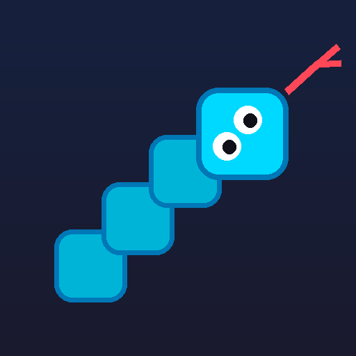

# 🐍 Snake Game

Juego de la Serpiente en **Python + tkinter**, con menú interactivo, niveles de dificultad, récords persistentes y movimiento interpolado a 60 FPS.



---

## ✨ Características

- **Menú interactivo** navegable con teclado (↑↓ + ENTER) y con **ratón** (clic y resaltado al pasar el cursor).
- **3 niveles de dificultad** que afectan de verdad al juego:

  | Dificultad | Velocidad | Puntos por comida |
  |---|---|---|
  | Fácil | 160 ms/celda | ×1.0 |
  | Normal | 120 ms/celda | ×1.5 |
  | Difícil | 85 ms/celda | ×2.0 |

- **Récords persistentes** en `%APPDATA%\SnakeGame\records.json`, con dificultad y fecha, y aviso de «NUEVO RÉCORD».
- **Movimiento fluido a 60 FPS**: cada segmento se interpola entre su celda anterior y la actual, en vez de saltar de celda en celda.
- **Efectos visuales**: partículas al comer, comida con pulso, sombras y ojos que miran hacia donde avanza la serpiente.
- **Niveles progresivos**: cada 50 puntos sube el nivel y acelera el juego (hasta un límite).

## 🎮 Controles

| Tecla | Acción |
|---|---|
| **Flechas** | Mover la serpiente |
| **ESPACIO** | Pausar / reanudar |
| **R** | Reiniciar la partida |
| **ESC** | Volver al menú |

## 🚀 Cómo jugar

### Opción 1: sin instalar nada (Windows)

Descarga `SnakeGame.exe` de este repositorio y haz doble clic. No requiere Python.

> **Nota:** la primera vez, Windows Defender podría mostrar un aviso. Es un falso positivo habitual en ejecutables creados con PyInstaller y sin firma digital. Elige «Ejecutar de todos modos».

### Opción 2: desde el código fuente

Requiere Python 3.8 o superior (tkinter viene incluido en la instalación estándar de Windows).

```bash
python snake_game.py
```

## 🛠️ Compilar el ejecutable

```bash
pip install pyinstaller
pyinstaller --noconfirm --onefile --windowed --name SnakeGame --icon snake.ico --distpath dist --workpath build --specpath . snake_game.py
```

> ⚠️ Ejecuta el comando **desde la raíz del proyecto**: PyInstaller resuelve la ruta de `--icon` relativa a la carpeta del archivo `.spec`, no al directorio de trabajo.

## 🧱 Arquitectura

El juego es un único archivo, `snake_game.py`, organizado en una máquina de estados de pantallas:

```
MENU → JUEGO → PAUSA / GAME_OVER
  ├── DIFICULTAD
  ├── RECORDS
  └── AYUDA
```

Decisiones técnicas destacables:

- **Lógica desacoplada del render.** El bucle corre a ~60 FPS midiendo el tiempo real, y la lógica de la rejilla avanza por un **acumulador de tiempo**. Así el juego va igual de rápido en cualquier máquina, sin depender de los FPS reales.
- **Interpolación del movimiento.** Cada segmento se dibuja entre su posición anterior y la actual, con un tope de 4 avances por frame para evitar la *spiral of death* si el sistema se atasca.
- **Render eficiente.** El tablero (480 celdas) se dibuja **una sola vez**; los objetos del canvas se reutilizan con `coords()` en lugar de destruirlos y recrearlos en cada frame. El coste medido es de ~0,23 ms por frame, un 1,4 % del presupuesto de 16 ms.
- **El bucle se detiene en los menús**, donde no hay nada que animar, así que no consume CPU.
- **Física por segundo, no por frame.** Las partículas y el pulso de la comida usan `dt`, así que se ven igual a cualquier tasa de refresco.

## 📁 Estructura

```
snake_game.py         Código fuente completo del juego
SnakeGame.exe         Ejecutable para Windows (sin dependencias)
snake.ico             Icono de la aplicación
snake_icon_256.png    Icono en PNG (vista previa)
SnakeGame.spec        Especificación de compilación de PyInstaller
```

## 📄 Licencia

Uso libre para fines educativos y personales.
